# Class Activity 1 — System Calls in Practice

- **Student Name:** Phy Sopanha
- **Student ID:** e20230530
- **Date:** 28/10/2026

---

## Warm-Up: Hello System Call

Screenshot of running `hello_syscall.c` on Linux:

Screenshot of running `hello_winapi.c` on Windows (CMD/PowerShell/VS Code):

Screenshot of running `copyfilesyscall.c` on Linux:

---

## Task 1: File Creator & Reader

### Part A — File Creator

**Describe your implementation:** The library version uses C standard I/O functions (`fopen`, `fprintf`) which handle buffering automatically in user space. The system call version interacts directly with the OS kernel using POSIX calls (`open`, `write`), requiring manual control over file descriptors and buffer sizes.

**Version A — Library Functions (`file_creator_lib.c`):**

**Version B — POSIX System Calls (`file_creator_sys.c`):**

**Questions:**

1. **What flags did you pass to `open()`? What does each flag mean?**

   > `O_WRONLY | O_CREAT | O_TRUNC`. 
   > `O_WRONLY` opens the file for writing only. `O_CREAT` creates the file if it does not already exist. `O_TRUNC` truncates (empties) the file to zero length if it already exists.

2. **What is `0644`? What does each digit represent?**

   > `0644` sets the file permissions in octal format. 
   > `0` indicates it is an octal number. `6` gives the file owner read and write permissions (4+2). `4` gives the user group read-only permission. The final `4` gives all other users read-only permission.

3. **What does `fopen("output.txt", "w")` do internally that you had to do manually?**

   > `fopen()` automatically allocates memory for a `FILE` structure, sets up an internal memory buffer to optimize disk writes, and calls the `open()` system call behind the scenes with the correct creation and truncation flags. 

### Part B — File Reader & Display

**Describe your implementation:** The library reader uses `fgets()` to read the file string-by-string. The system call reader uses a `while` loop with `read()` and `write()`, moving raw byte chunks from the file descriptor into a buffer, and then pushing those bytes directly to the terminal's standard output (file descriptor 1).

**Version A — Library Functions (`file_reader_lib.c`):**

**Version B — POSIX System Calls (`file_reader_sys.c`):**

**Questions:**

1. **What does `read()` return? How is this different from `fgets()`?**

   > `read()` returns a `ssize_t` integer representing the exact number of bytes successfully read into the buffer. `fgets()` returns a pointer to the string that was read (or NULL on failure/EOF).

2. **Why do you need a loop when using `read()`? When does it stop?**

   > A loop is needed because `read()` only fetches a specific number of bytes up to the size of the buffer. If the file is larger than the buffer, you must call it multiple times to retrieve everything. It stops when `read()` returns `0`, indicating it has reached the End of File (EOF).

---

## Task 2: Directory Listing & File Info

**Describe your implementation:** I utilized the C standard library's `opendir()` and `readdir()` to iterate through the directory contents, passing the filenames to the `stat()` function to extract metadata like the file size in bytes.

### Version A — Library Functions (`dir_list_lib.c`)

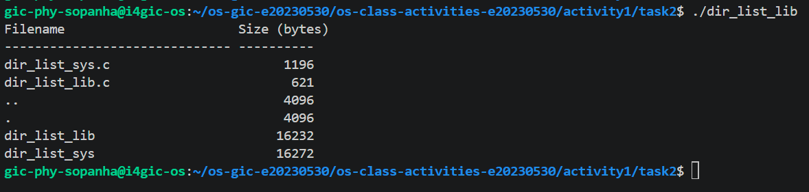

### Version B — System Calls (`dir_list_sys.c`)

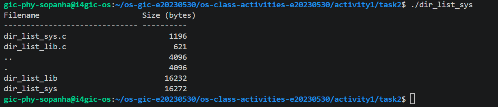

### Questions

1. **What struct does `readdir()` return? What fields does it contain?**

   > It returns a `dirent` struct. This struct contains fields such as `d_ino` (inode number), `d_off` (offset to the next dirent), `d_reclen` (length of this record), `d_type` (type of file), and `d_name` (the actual null-terminated filename).

2. **What information does `stat()` provide beyond file size?**

   > `stat()` provides extensive metadata including the file's inode number, owner UID/GID, permission bits, number of hard links, and timestamps for last access, modification, and status change.

3. **Why can't you `write()` a number directly — why do you need `snprintf()` first?**

   > The `write()` system call only understands raw bytes and characters. It does not know how to format an integer into human-readable ASCII text. `snprintf()` is required to convert the integer values (like file size) into a string representation before it can be written to the terminal.

---

## Optional Bonus: Windows API (`file_creator_win.c`)

Screenshot of running on Windows:

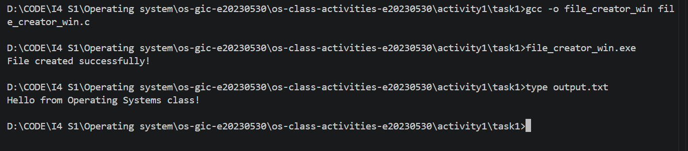

### Bonus Questions

1. **Why does Windows use `HANDLE` instead of integer file descriptors?**

   > Windows uses `HANDLE` (an opaque pointer) to provide a unified, secure abstraction for all kernel objects (files, threads, processes, memory blocks), allowing the OS to tightly manage access and reference counting without exposing internal memory structures to user space.

2. **What is the Windows equivalent of POSIX `fork()`? Why is it different?**

   > The equivalent is `CreateProcess()`. It is different because `CreateProcess()` initializes a completely new process with a new memory space and executable from scratch, whereas `fork()` clones the existing calling process's exact state and memory.

3. **Can you use POSIX calls on Windows?**

   > Not natively. Standard Windows relies on the Win32 API. To use POSIX calls on Windows, you must use a compatibility layer or subsystem, such as Windows Subsystem for Linux (WSL), Cygwin, or MinGW.

---

## Task 3: strace Analysis

**Describe what you observed:** The library version executed significantly more system calls than the raw system call version. It spent a lot of time allocating memory and mapping libraries before it even opened the target text file.

### strace Output — Library Version (File Creator)

### strace Output — System Call Version (File Creator)

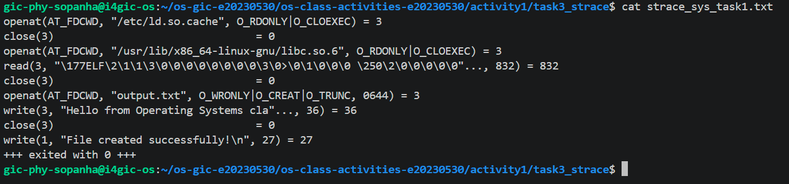

### strace Output — Library Version (File Reader or Dir Listing)

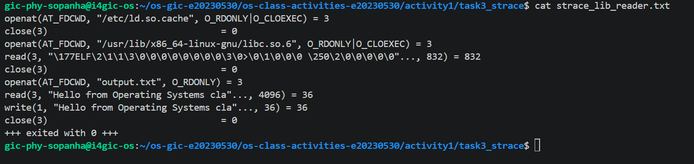

### strace Output — System Call Version (File Reader or Dir Listing)

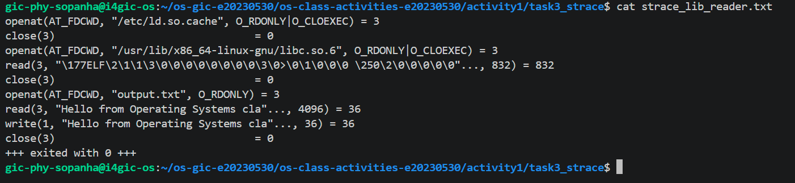

### strace -c Summary Comparison

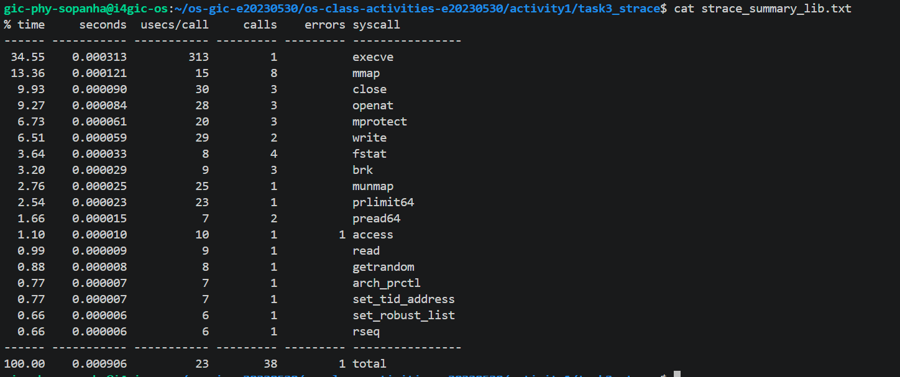
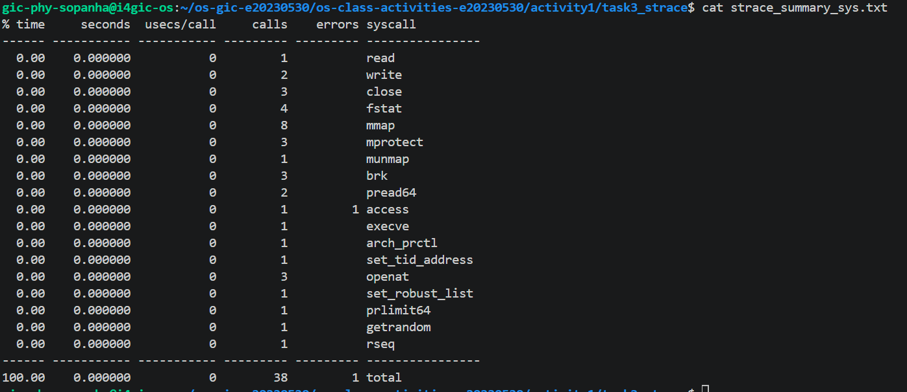

### Questions

1. **How many system calls does the library version make compared to the system call version?**

   > The library version makes several dozen system calls to complete the task, while the raw system call version executes the task using only a handful of core calls (typically less than 10).

2. **What extra system calls appear in the library version? What do they do?**

   > Extra calls like `mmap`, `mprotect`, and `brk` appear. These are memory management system calls used to map dynamic shared libraries (like libc) into memory, set permissions on those memory regions, and allocate space for the C standard library's internal I/O buffers.

3. **How many `write()` calls does `fprintf()` actually produce?**

   > Because `fprintf()` buffers data in user space, it typically only produces one single `write()` system call at the very end when the buffer is flushed, or when the file is closed, rather than calling `write()` for every single character or string appended.

4. **In your own words, what is the real difference between a library function and a system call?**

   > A library function is a higher-level wrapper written in a language (like C) that runs entirely in user space, offering convenience and optimization (like buffering). A system call is a direct, privileged instruction requesting the Operating System kernel to perform an action (like reading hardware) on the program's behalf.

---

## Task 4: Exploring OS Structure

### System Information

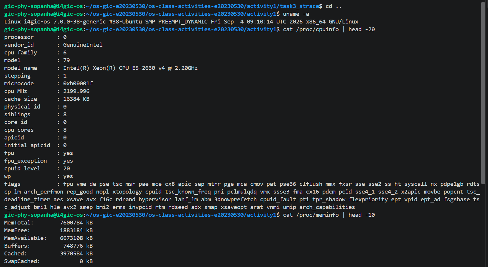
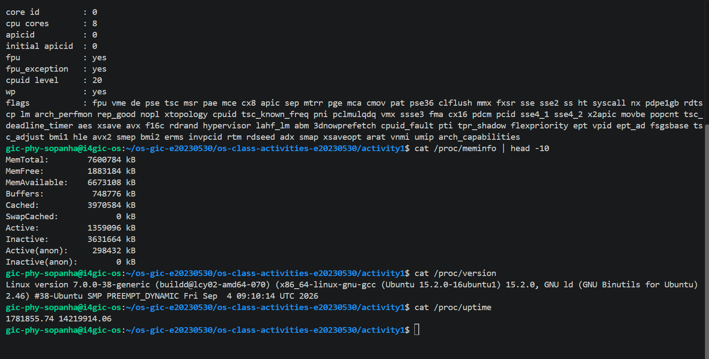

### Process Information

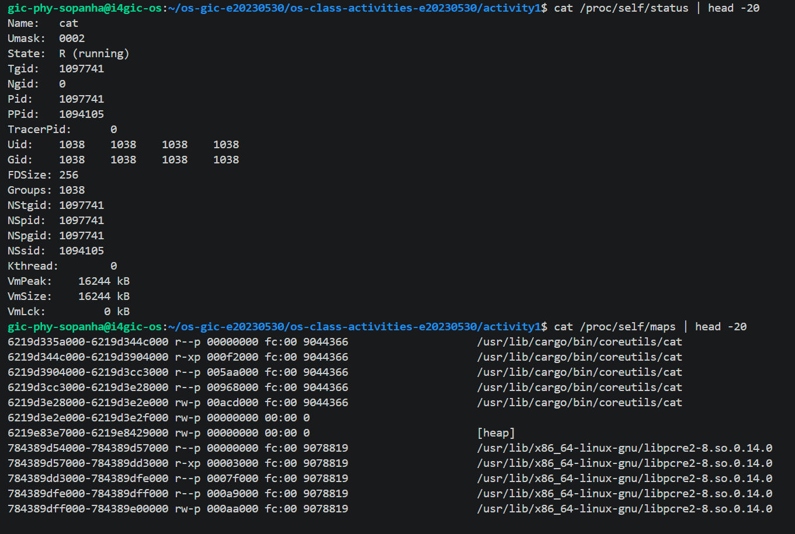 
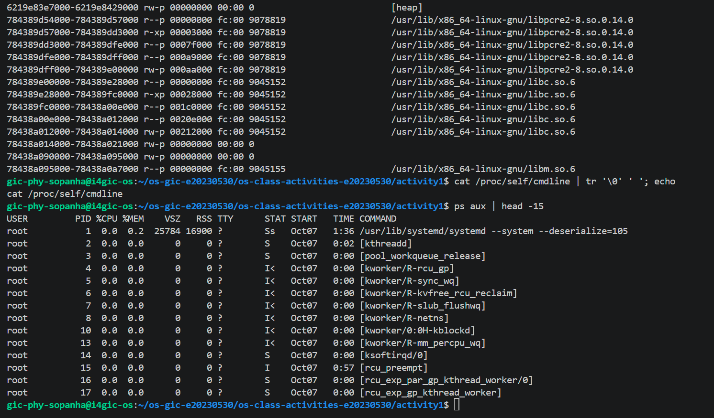 

### Kernel Modules

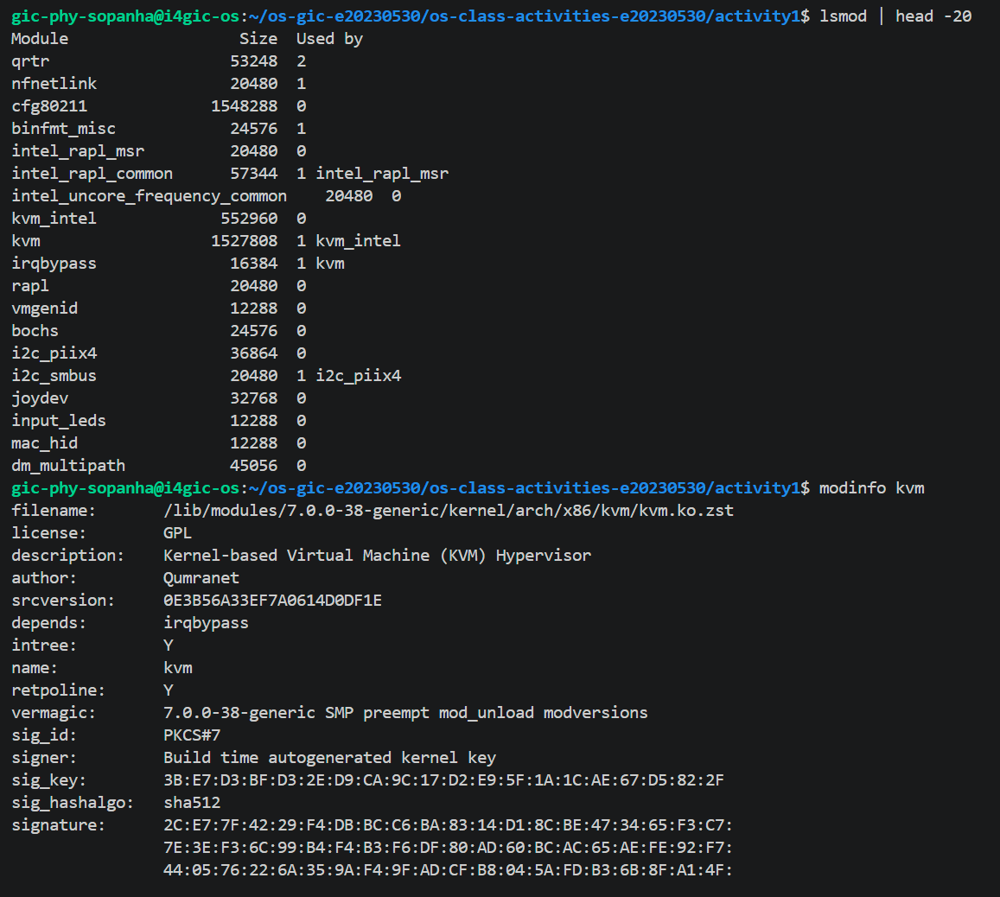 
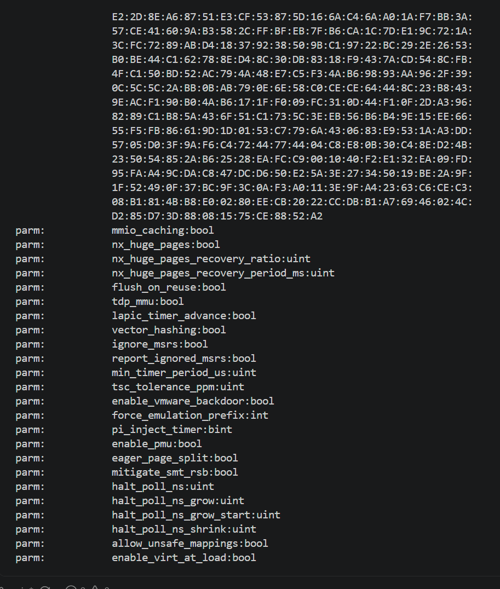

### OS Layers Diagram

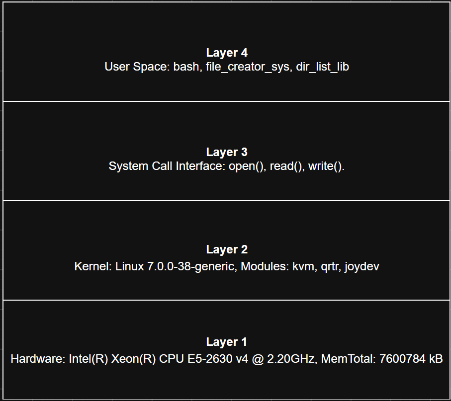

### Questions

1. **What is `/proc`? Is it a real filesystem on disk?**

   > `/proc` is a virtual filesystem. It is not stored on a physical disk. The kernel generates its contents on the fly in RAM whenever a file is read, acting as an interface to view real-time system and process information.

2. **Monolithic kernel vs. microkernel — which type does Linux use?**

   > A monolithic kernel runs core services (drivers, networking) inside the main kernel space for speed, while a microkernel keeps the core minimal and runs services in user space for stability. Based on the `lsmod` output showing dynamic modules loaded directly into the kernel, Linux utilizes a modular monolithic kernel.

3. **What memory regions do you see in `/proc/self/maps`?**

   > The memory regions include the executable binary code, the dynamic memory `[heap]`, and dynamically shared C libraries (such as `libc.so.6` and `libpcre2-8.so`) mapped into the process's address space.

4. **Break down the kernel version string from `uname -a`.**

   > - `Linux`: The kernel name.
   > - `i4gic-os`: The network hostname.
   > - `7.0.0-38-generic`: The specific kernel release version.
   > - `#38-Ubuntu SMP PREEMPT_DYNAMIC...`: Kernel build details, indicating Symmetric Multiprocessing support and the compilation date.
   > - `x86_64`: The 64-bit hardware architecture.
   > - `GNU/Linux`: The operating system name.

5. **How does `/proc` show that the OS is an intermediary between programs and hardware?**

   > `/proc` provides a safe, standard file interface for user programs to access deep hardware details (like CPU architecture and RAM capacity) without allowing the programs to touch the hardware directly. The OS intercepts the file read, queries the hardware securely, and hands the text response back to the user space program.

---

## Reflection

What did you learn from this activity? What was the most surprising difference between library functions and system calls?

> Through this activity, I gained hands-on experience bridging theoretical OS concepts with practical system programming. I learned how to directly request resources from the kernel using POSIX standard calls and how to inspect running process behavior using tools like `strace` and the `/proc` virtual filesystem. The most surprising difference was visually seeing how much unseen work (like memory allocation and library mapping) happens behind the scenes of a simple C library function like `fopen()` or `fprintf()`, and how heavily the library relies on buffering to minimize the expensive overhead of crossing into kernel space.