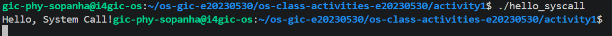
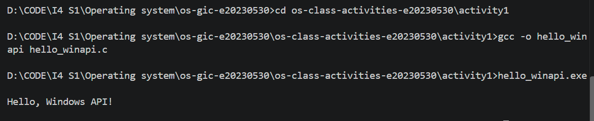
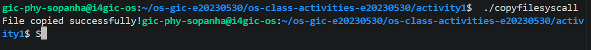
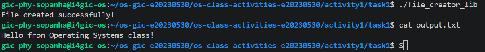
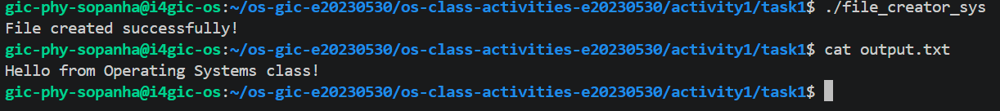
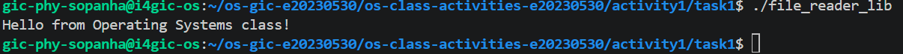
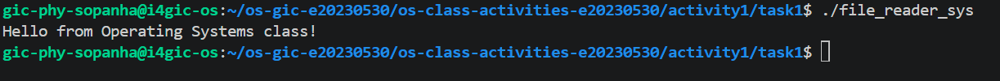

# Class Activity 1 — System Calls in Practice

- **Student Name:** Phy Sopanha
- **Student ID:** e20230530
- **Date:** October 28, 2026

---

## Warm-Up: Hello System Call

Screenshot of running `hello_syscall.c` on Linux:

Screenshot of running `hello_winapi.c` on Windows (CMD/PowerShell/VS Code):

Screenshot of running `copyfilesyscall.c` on Linux:

---

## Task 1: File Creator & Reader

### Part A — File Creator

**Describe your implementation:** The library version uses standard C functions which handle background buffering and file permissions automatically, while the system call version requires explicitly defining flags (O_WRONLY, O_CREAT, O_TRUNC) and exact permission modes (0644) to interact directly with the kernel.

**Version A — Library Functions (`file_creator_lib.c`):**

**Version B — POSIX System Calls (`file_creator_sys.c`):**

**Questions:**

1. **What flags did you pass to `open()`? What does each flag mean?**

   > `O_WRONLY`: Opens the file for writing only. `O_CREAT`: Creates the file if it does not already exist. `O_TRUNC`: Truncates (clears) the file's contents to zero length if it already exists.

2. **What is `0644`? What does each digit represent?**

   > The 0 indicates it is an octal number. The 6 represents the Owner permissions: read (4) + write (2). The first 4 represents Group permissions: read-only (4). The second 4 represents Others/Public permissions: read-only (4).

3. **What does `fopen("output.txt", "w")` do internally that you had to do manually?**

   > When you pass "w" to `fopen()`, the C standard library automatically combines the system-level flags to create the file if missing, open it as write-only, and truncate it.

### Part B — File Reader & Display

**Describe your implementation:** The system call implementation reads raw bytes into a fixed-size buffer using file descriptors, whereas the library version uses high-level streams.

**Version A — Library Functions (`file_reader_lib.c`):**

**Version B — POSIX System Calls (`file_reader_sys.c`):**

**Questions:**

1. **What does `read()` return? How is this different from `fgets()`?**

   > `read()` returns the number of bytes successfully read as an integer (or -1 on error, 0 on EOF). This is different from `fgets()`, which reads until a newline or EOF and returns a string pointer (char*).

2. **Why do you need a loop when using `read()`? When does it stop?**

   > You need a loop because a single `read()` call might not read the entire file into the buffer at once, especially for large files. It stops when `read()` returns 0, indicating the End of File (EOF) has been reached.

---

## Task 2: Directory Listing & File Info

**Describe your implementation:** I replaced `printf()` with `write()`. Because `write()` only handles string buffers, I had to use `snprintf()` to format the file sizes and names into a string buffer before writing them to standard output (file descriptor 1).