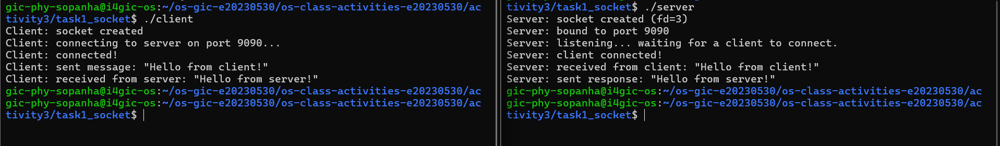
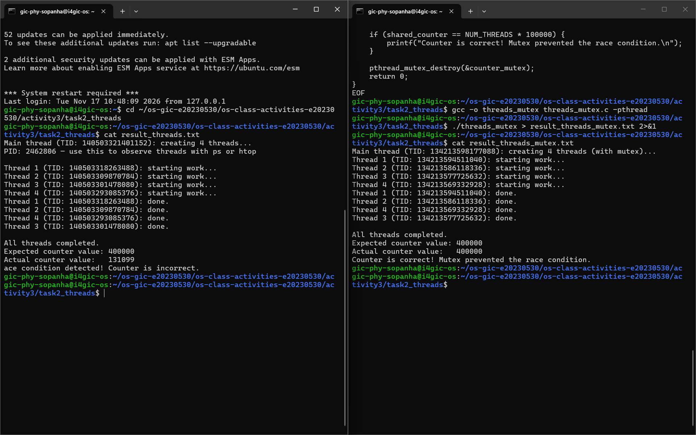
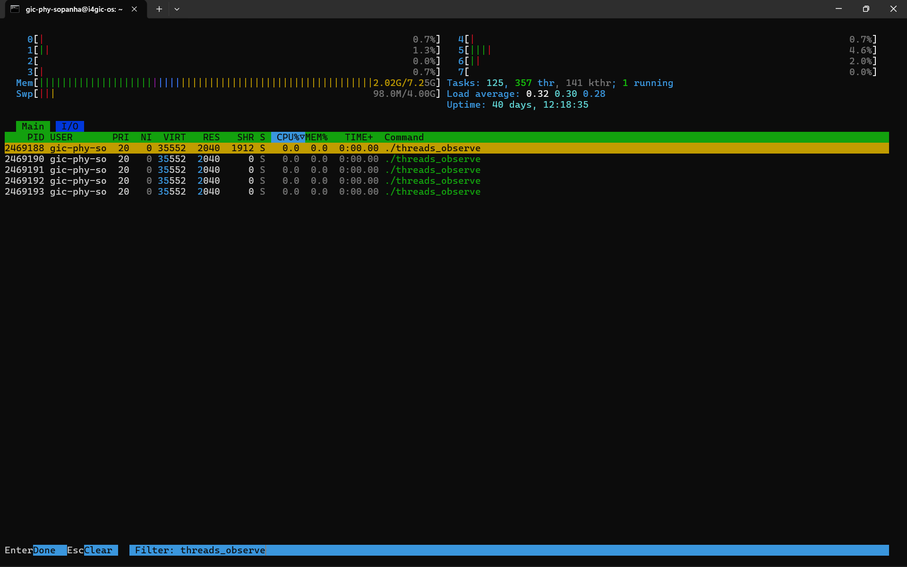
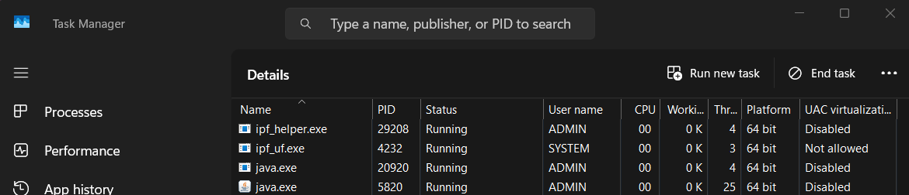

# Class Activity 3 — Socket Communication & Multithreading

- **Student Name:** Phy Sopanha
- **Student ID:** e20230530
- **Date:** November 17, 2026

---

## Task 1: TCP Socket Communication (C)

### Compilation & Execution

### Answers

1. **Role of `bind()` / Why client doesn't call it:**
   > `bind()` associates the server socket with a specific IP address and port number on the machine so it can listen for incoming connections. The client doesn't need to call `bind()` because the OS automatically assigns it a random, available "ephemeral" port when it calls `connect()`.

2. **What `accept()` returns:**
   > `accept()` returns a brand new file descriptor specifically for the connected client. This is different from the original server socket, which remains open solely to listen for more incoming connections.

3. **Starting client before server:**
   > If the client starts first, it crashes with a `Connection refused` error because there is no server process actively listening on that port to complete the TCP handshake.

4. **What `htons()` does:**
   > `htons()` (Host TO Network Short) converts the port number from the host computer's byte order (little-endian) to network byte order (big-endian). This ensures data is interpreted correctly across different computer architectures over the network.

5. **Socket call sequence diagram:**
   > **Server:** `socket()` → `bind()` → `listen()` → `accept()` → `read()`/`write()` → `close()`
   > **Client:** `socket()` → `connect()` → `write()`/`read()` → `close()`

---

## Task 2: POSIX Threads (C)

### Output — Without Mutex (Race Condition) & With Mutex (Correct)

### Answers

1. **What is a race condition?**
   > A race condition happens when multiple threads access and modify shared data simultaneously without synchronization. In `threads.c`, threads read the old `shared_counter` value, increment it, and write it back at the exact same time, overwriting each other's work and resulting in a lower final count.

2. **What does `pthread_mutex_lock()` do?**
   > It places an exclusive lock on the mutex. If another thread already holds the lock, the calling thread pauses (blocks) until it is unlocked. This fixes the race condition by guaranteeing only one thread can modify `shared_counter` at a time.

3. **Removing `pthread_join()`:**
   > If removed, the main thread will immediately reach `return 0;` and exit the program before the worker threads finish their loops, terminating them prematurely.

4. **Thread vs Process:**
   > A process is an independent execution environment with its own memory space. A thread is a lightweight execution unit *within* a process. Threads share the process's code, data, heap, and open files, but each thread has its own private stack, registers, and Thread ID.

---

## Task 3: Java Multithreading

### ThreadDemo, RunnableDemo, and PoolDemo Output

### Answers

1. **Thread vs Runnable:**
   > Extending `Thread` prevents your class from inheriting from any other class (Java doesn't support multiple inheritance). Implementing `Runnable` is better because it separates the task logic from the thread execution, allowing your class to inherit from elsewhere.

2. **Pool size limiting concurrency:**
   > We instantiated a fixed thread pool of size 2 (`Executors.newFixedThreadPool(2)`). Therefore, the `ExecutorService` only allows 2 threads to be active simultaneously; the other 4 submitted tasks wait in an internal queue until a thread finishes its current task.

3. **thread.join() in Java:**
   > `thread.join()` forces the main thread to pause and wait until the specified thread has completely finished executing. If removed, the main thread will print "all threads finished" and exit before the custom threads finish their work.

4. **ExecutorService advantages:**
   > It abstracts away the manual creation and management of threads. It reuses existing threads (reducing memory/CPU overhead) and manages an internal queue, preventing the system from crashing if thousands of tasks are submitted at once.

---

## Task 4: Observing Threads

### Linux — `ps -eLf` Output

*(See `result_observe_linux.txt` in repository)*

### Linux — htop Thread View

### Windows — Task Manager

### Answers

1. **LWP column meaning:**
   > LWP stands for Light Weight Process. In Linux, threads are treated as LWPs by the kernel. This column displays the unique ID assigned by the OS to schedule that specific thread.

2. **/proc/PID/task/ count:**
   > The directory contains 5 folders (one for the main thread, plus the 4 worker threads). Yes, this perfectly matches the number of threads created in the program.

3. **Extra Java threads:**
   > `java.exe` shows many more threads because the Java Virtual Machine (JVM) automatically creates several background system threads to manage the environment, such as the Garbage Collector, JIT Compiler, and Signal Dispatchers.

4. **Linux vs Windows thread viewing:**
   > Linux command-line tools (`ps`, `htop`, `/proc`) provide deep, granular details about individual threads (LWP IDs, individual thread CPU scheduling). Windows Task Manager only provides a high-level summary count of threads, requiring specialized tools to see deeper details.

---

## Reflection

> This activity demonstrated the fundamental differences in how processes and threads communicate and share memory. Using sockets showed how separate processes require strict network protocols (TCP) to talk, whereas threads automatically share the same memory space, making them faster but vulnerable to race conditions. Learning to use mutexes in C and Thread Pools in Java highlighted how crucial synchronization is for stable concurrent programming.