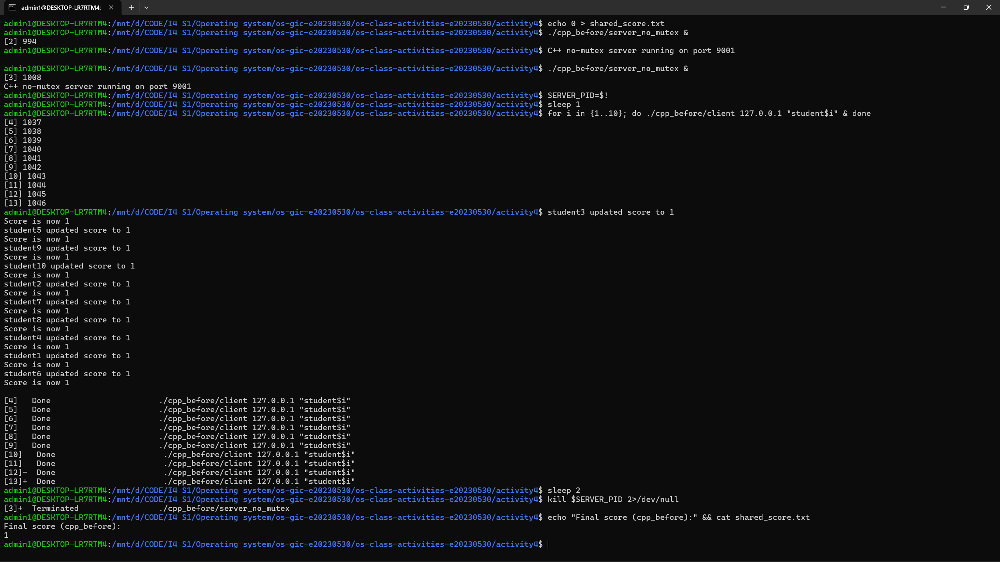
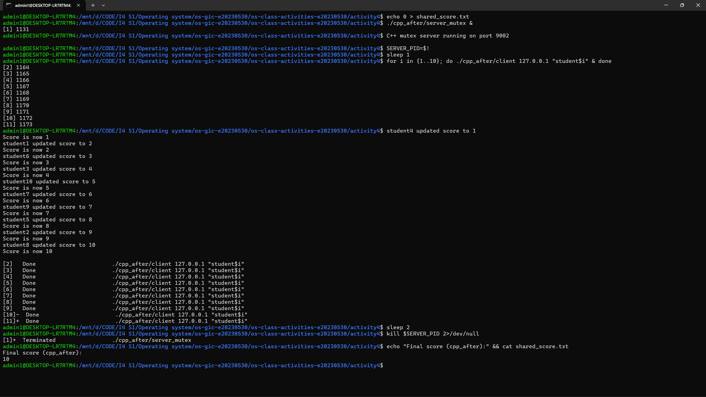
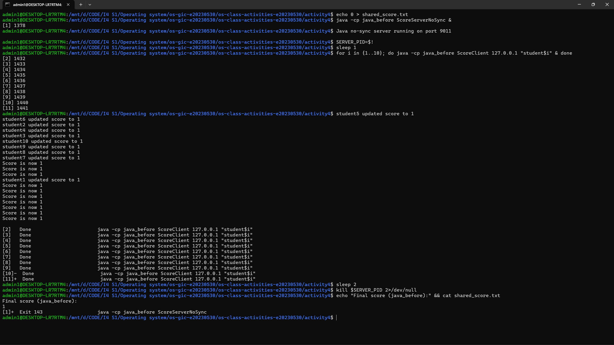
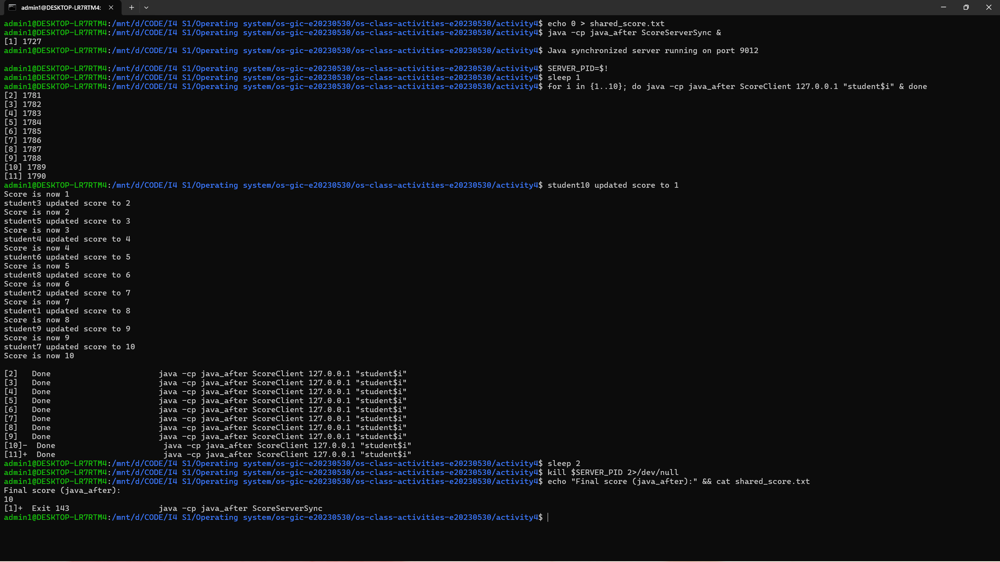

# Activity 4 — Race Conditions & Thread Synchronization (C++ & Java)

- **Name:** Phy Sopanha
- **Student ID:** e20230530

## Overview

This activity demonstrates a **race condition** when 10 concurrent clients update a shared file (`shared_score.txt`) simultaneously, and how **mutual exclusion** (`std::mutex` in C++ and `synchronized` in Java) prevents lost updates.

## Summary of Results

| Implementation | Version | Synchronization | Expected Score | Actual Score | Result |
| :--- | :--- | :--- | :---: | :---: | :--- |
| **C++** (`server_no_mutex`) | Before | None | 10 | 1 | Race condition (9 updates lost) |
| **C++** (`server_mutex`) | After | `std::mutex` | 10 | 10 | Synchronized (no lost updates) |
| **Java** (`ScoreServerNoSync`) | Before | None | 10 | 1 | Race condition (9 updates lost) |
| **Java** (`ScoreServerSync`) | After | `synchronized` | 10 | 10 | Synchronized (no lost updates) |

---

## 1. C++ Implementation

### Before (`cpp_before` — No Mutex)
Multiple client handler threads read `shared_score.txt` (`0`) at the same time, incremented it to `1`, and overwrote each other's writes.

### After (`cpp_after` — With Mutex)
Wrapping the read-modify-write critical section with a mutex ensured only one thread accessed `shared_score.txt` at a time, incrementing sequentially from `1` to `10`.

---

## 2. Java Implementation

### Before (`java_before` — No Synchronization)
Without synchronization, all 10 client threads raced on `shared_score.txt`, causing lost updates and leaving the final score at `1`.

### After (`java_after` — Synchronized)
Using `synchronized` to guard the critical section serialized access to `shared_score.txt`, producing the expected final score of `10`.

