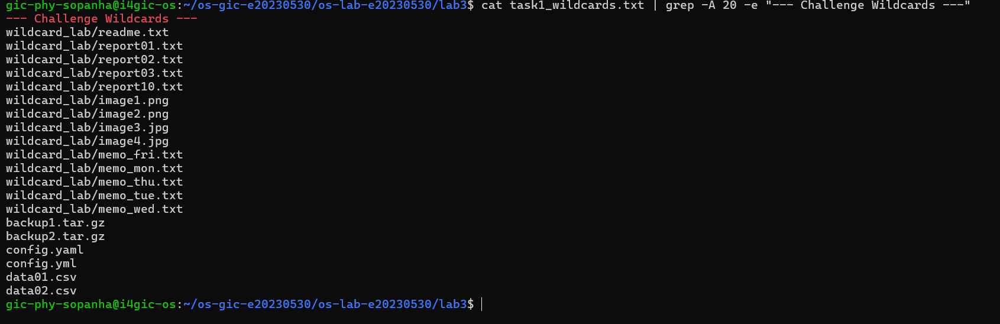
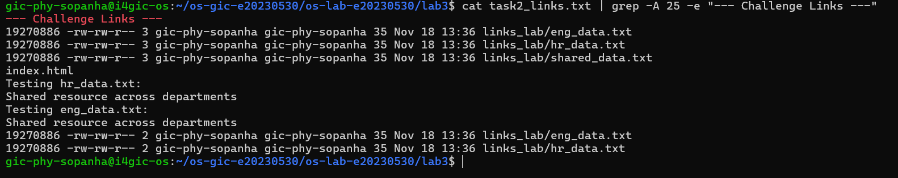
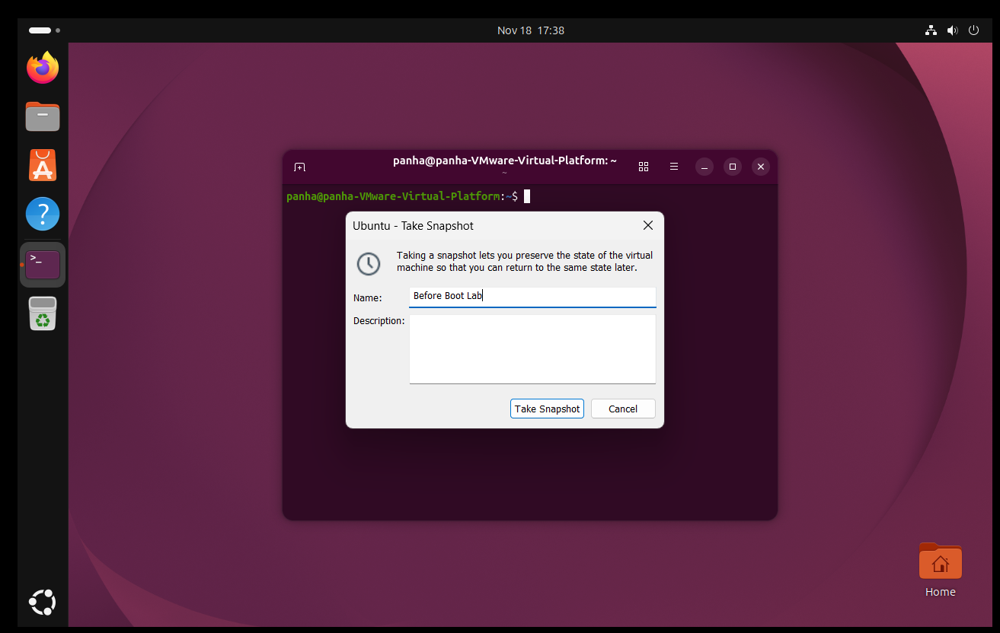
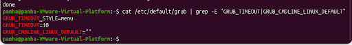
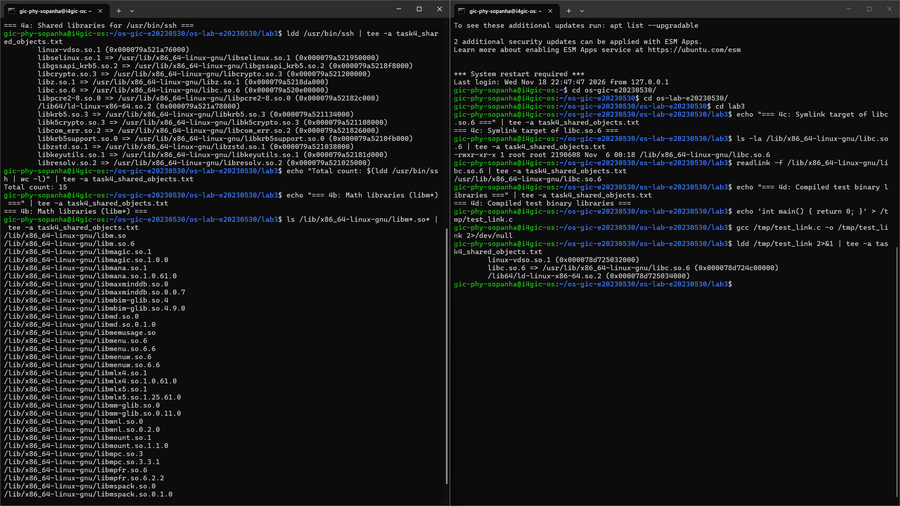
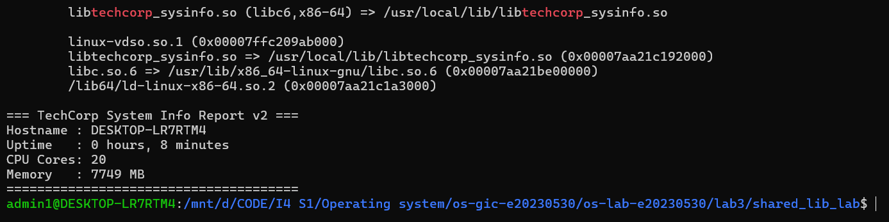
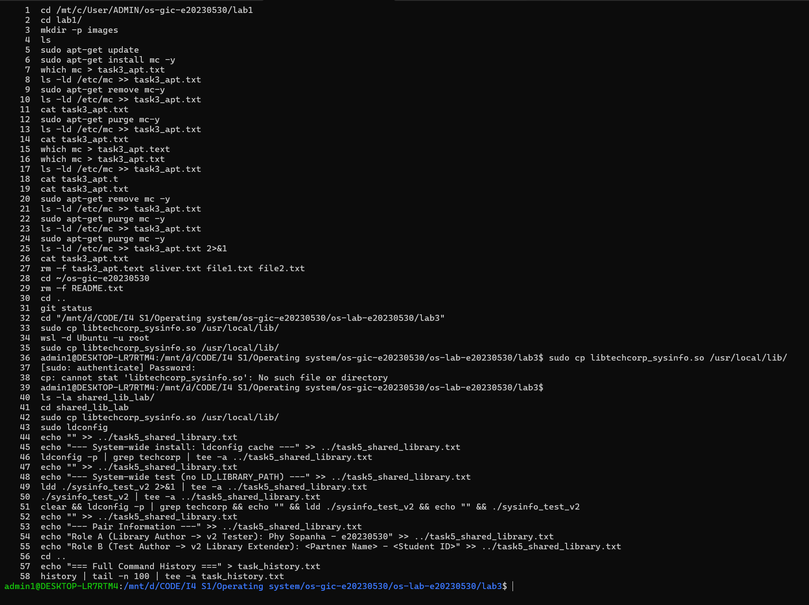

# Lab 3 — Wildcards, Links, GRUB & Shared Libraries

- **Student Name:** Phy Sopanha
- **Student ID:** e20230530
- **Course:** Operating Systems (GIC - ITC)
- **Date:** November 18, 2026

---

## Task 1 — Wildcards & File Globbing
Explored shell pattern matching (`*`, `?`, `[...]`, `{...}`) to filter, list, and organize files inside `wildcard_lab/`.
- **Output file:** [`task1_wildcards.txt`](./task1_wildcards.txt)

---

## Task 2 — Hard Links & Symbolic Links
Created and compared hard links (sharing the same inode) and symbolic links (pointing to a path, which breaks if the target is removed or moved) inside `links_lab/`.
- **Output file:** [`task2_links.txt`](./task2_links.txt)

---

## Task 3 — GRUB Bootloader Configuration & Recovery
Configured GRUB timeout, custom menu entries, background image, and colors in an Ubuntu VM, then practiced recovery mode, intentionally breaking GRUB, manually booting from the `grub>` prompt, and restoring the configuration.
- **Output file:** [`task3_grub.txt`](./task3_grub.txt)

| Step | Screenshot |
| :--- | :--- |
| VM Snapshot |  |
| GRUB Timeout (`GRUB_TIMEOUT=10`) |  |
| Custom Menu Entry |  |
| Custom Background |  |
| Recovery Mode |  |
| Broken GRUB (`grub>`) |  |
| Manual Boot |  |
| Restored System |  |
| Challenge (Colors & UUID) |  |

---

## Task 4 — Shared Objects (Dynamic Libraries) Exploration
Investigated how Linux binaries resolve dynamic `.so` dependencies at runtime using `ldd`, `ldconfig -p`, `file`, `readelf`, and `/proc/$$/maps`.
- **Output file:** [`task4_shared_objects.txt`](./task4_shared_objects.txt)
- **Key Challenge Findings:**
  - `/usr/bin/ssh` depends on 15 shared libraries.
  - `/lib/x86_64-linux-gnu/libc.so.6` is a regular ELF shared object file on this Ubuntu version rather than a symlink.

---

## Task 5 — Build & Register a Shared Library (Pair Task)
Designed a shared library API (`techcorp_sysinfo.h`), compiled `libtechcorp_sysinfo.so` using `gcc -fPIC -shared`, extended it with `tc_get_memory_mb()`, and installed it system-wide to `/usr/local/lib/` with `sudo ldconfig` so `sysinfo_test_v2` runs without `LD_LIBRARY_PATH`.
- **Output file:** [`task5_shared_library.txt`](./task5_shared_library.txt)
- **Pair Information:**
  - **Role A (Library Author → v2 Tester):** Phy Sopanha (`e20230530`)
  - **Role B (Test Author → v2 Library Extender):** `<Partner Name>` (`<Partner ID>`)

### API Design
 don't have yet

### Final System-Wide Integration

---

## Command History
- **Output file:** [`task_history.txt`](./task_history.txt)

